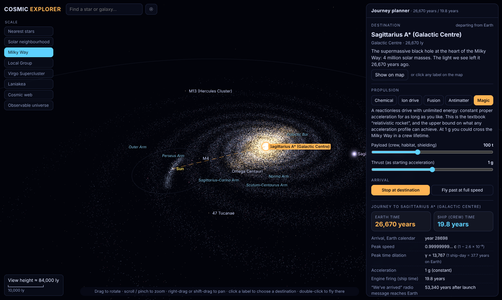

# Cosmic Explorer

A single-page, zero-install 3D map of the universe, from the nearest stars out to the edge of the observable universe, with a relativistic journey planner.

**▶ Try it live: [hughesalex.github.io/CosmicExplorer](https://hughesalex.github.io/CosmicExplorer/)**

To run it locally, open `index.html` in a modern browser. It loads Three.js from a CDN, so you need an internet connection the first time.

## The map

* **Drag** to rotate, **scroll / pinch** to zoom, **right-drag or shift-drag** to pan.
* The **Scale** buttons fly between levels: nearest stars, solar neighbourhood, Milky Way, Local Group, Virgo Supercluster, Laniakea, cosmic web and the observable universe.
* **Click** a label to make it your destination. **Double-click** (or use *Show on map*) to fly there.
* Faint rings around the Sun mark powers of ten in distance (1 ly, 10 ly, 100 ly…), so you can always read the scale.

The view spans more than 11 orders of magnitude. To keep it numerically stable, everything is stored in light-years as 64-bit doubles. Each frame, objects are placed relative to a floating origin (the point you are looking at) and divided by the current view radius, so the GPU only ever sees numbers of order 1. Camera flights use the van Wijk–Nuij “optimal zoom-and-pan” path, which zooms out, travels and zooms back in smoothly across any change of scale.

Star, nebula, galaxy, cluster and quasar positions come from real catalogue coordinates and distances. Distant objects are placed at their present-day (comoving) distance, computed from their redshift. The Milky Way's structure, the background field stars, the galaxy field and the cosmic web are procedurally generated illustrations, anchored on real clusters and voids.

## The journey planner

Pick a drive from the drop-down: chemical, ion (solar or nuclear-electric), four fission concepts (solid-core nuclear thermal, gas-core nuclear thermal, fission-fragment and Orion-style nuclear pulse), fusion, antimatter or “magic”, set the payload, propellant, exhaust velocity and thrust, and choose whether to **stop** at the destination or **fly past** at full speed. The planner reports:

* **Earth time**: how long the trip takes for people at home (cosmic time for very distant trips).
* **Ship time**: how long the crew's clocks record.
* Peak speed, Lorentz factor, acceleration, propellant used, engine firing time, jet power, and when an “arrived” radio message would reach Earth.
* A **thrust vs. trip time** chart with the optimum marked. More thrust needs a bigger engine and power plant (set by *Engine technology level*, in W/kg), which eats into the mass ratio. So for a given load of propellant there is a thrust that gives the shortest trip. *Use optimum* sets it.

### Physics

* Exact relativistic rocket equation: total rapidity = *w* · ln(*m₀* / *m_dry*), where *w* is the exhaust speed. Thrust is constant, so acceleration rises as propellant is burned.
* Engine mass = jet power / specific power, with jet power per newton of thrust = (γ_w − 1)c² / (γ_w w), which is w/2 for slow exhausts and c for a photon rocket.
* A rendezvous trip spends half its rapidity speeding up and half slowing down, coasting in between if propellant allows.
* The motion is integrated in the ship's proper time (RK4) using
  `dt/dτ = cosh φ`, `dφ/dτ = ±α − H(t) sinh φ`, `dχ/dτ = sinh φ / a(t)`.
* Beyond 10 million light-years the trip is flown through a flat ΛCDM universe (H₀ = 67.7 km/s/Mpc, Ωm = 0.31, ΩΛ = 0.69). Coasting ships lose speed relative to the Hubble flow, slow ships can stall forever, and nothing can reach objects beyond the cosmic event horizon (~16.6 billion ly today). Inside the gravitationally bound Local Group, ordinary special relativity is used.

Sanity checks: a 1 g “magic” drive reaches Proxima Centauri in 3.5 years of ship time (5.9 Earth years), and stops at Andromeda after 28.6 ship years (2.54 million Earth years).
